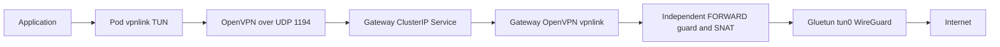

# k8s-vpn-gateway

Route selected Kubernetes workloads through one shared [Gluetun](https://github.com/passteque/gluetun)
VPN gateway. Applications use ordinary TCP, UDP and DNS sockets. A TLS-authenticated
OpenVPN tunnel carries their IP packets to the gateway; Gluetun runs the provider
VPN **only once**, in the gateway Pod.

**Experimental software.** Read the [security model](docs/security.md) and
[verification record](docs/verification.md) before using it for sensitive traffic.
An unavailable VPN deliberately means unavailable Internet access.

```yaml
apiVersion: apps/v1
kind: Deployment
metadata:
  name: example
  annotations:
    pass-to-vpn: "true"
spec:
  # ... an ordinary Deployment with the application security context below
```

## How it works



A restartable init sidecar installs nftables rules **before any application init
container starts**. The rules outlive the sidecar process and allow ordinary
interface egress only for the authenticated tunnel transport and the trusted
resolver's cluster DNS queries. No code restores direct Internet access. A
separate gateway firewall restricts forwarded client packets to `tun0`, even
while Gluetun starts or reconnects. IPv6 is blocked on clients.

There are no CRDs, node agents, DHCP, privileged containers, host networking or
changes to node routing. `/dev/net/tun` is the sole injected host device.

## Requirements

- Linux Kubernetes 1.33+ with native sidecars, working nftables and TUN devices.
- cert-manager with its CA injector, already installed.
- IPv4 Pod/Service networks within private address space, not overlapping
  `198.18.0.0/24`. That fixed subnet is reserved for the overlay (200 clients).
- Gateway network namespace has IPv4 forwarding enabled and `rp_filter=0` for
  `all` and `default`. The guard checks these and refuses to start if they differ;
  it does not modify node sysctls. See [operations](docs/operations.md).
- Namespace Pod Security exemptions for `NET_ADMIN`, root in trusted network
  containers and the `/dev/net/tun` device. PSA `baseline`/`restricted` reject
  this pattern. The chart does not weaken existing namespace labels.
- UDP 1194 allowed between client Pods and the gateway Service/Pod, including
  across nodes. The provider endpoint must be reachable from the gateway.

## Install

Install one release per cluster. Create a dedicated infrastructure namespace and
explicitly approved application namespaces. Both admission registrations are
restricted to these namespaces by their built-in name labels. Annotations
outside enrolled namespaces have no effect. See [namespace examples](examples/namespaces.yaml);
`enforce: privileged` is a namespace PSA allowance, **not** a privileged container.
Restrict who can create workloads there using ordinary Kubernetes RBAC.

Provide a WireGuard configuration through an existing Secret, never through Helm
values, Git or a Docker build context. `wg0.conf` must use a literal IPv4 endpoint.
Only the gateway mounts this provider credential.

```sh
export KUBECONFIG=/absolute/private/path/to/kubeconfig
KUBECONFIG="$KUBECONFIG" kubectl apply -f examples/namespaces.yaml
KUBECONFIG="$KUBECONFIG" kubectl -n vpn-gateway create secret generic vpn-provider \
  --from-file=wg0.conf=/absolute/private/path/provider.conf

# Replace the image digest with the one produced by the repository CI.
KUBECONFIG="$KUBECONFIG" helm upgrade --install vpn-gateway charts/vpn-gateway \
  --namespace vpn-gateway --set image=ghcr.io/alexxanddr/k8s-vpn-gateway@sha256:IMAGE_DIGEST \
  --set clusterDNS=CLUSTER_DNS_IPV4 --set 'clientNamespaces[0]=vpn-apps' \
  --wait --timeout 5m
KUBECONFIG="$KUBECONFIG" kubectl -n vpn-gateway rollout status deployment/vpn-admission
KUBECONFIG="$KUBECONFIG" kubectl -n vpn-gateway rollout status deployment/vpn-gateway
KUBECONFIG="$KUBECONFIG" kubectl apply -n vpn-apps -f examples/deployment.yaml
```

The kubeconfig in these commands is explicitly selected; adapt its path when
installing into your own cluster. No local overrides are checked in.

`clusterDNS` is mandatory: inspect your actual DNS Service. `publicDNS` defaults
to `1.1.1.1` through the VPN. The chart creates a short-lived transport client
certificate through cert-manager and pre-creates its destination Secret in each
listed application namespace. Admission syncs only that named Secret; provider
credentials and the CA private key are never copied to application namespaces.
Do not set the infrastructure namespace as a client namespace.

For GitOps, [Flux example](examples/flux.yaml) uses the same chart from Git.
Provision the provider Secret separately with your existing encrypted Secret
workflow. Wait for this release before reconciling selected applications.

## Application contract

Use this security context for **every application and user init container**:

```yaml
securityContext:
  runAsUser: 1000
  runAsNonRoot: true
  allowPrivilegeEscalation: false
  capabilities:
    drop: [ALL]
  seccompProfile:
    type: RuntimeDefault
```

The application cannot use root, added capabilities (including `NET_RAW` and
`NET_ADMIN`), privileged mode, shared/host namespaces, user namespaces, hostPath,
CSI or raw device volumes, host ports or unmasked proc. Use **exec probes**;
ordinary inbound connections and replies are blocked in this initial version.
Ephemeral debug containers must obey the same rules. Existing Deployments are not
restarted by installing or upgrading this project.

Selection values are exactly the strings `"true"` and `"false"`:

1. A Pod's explicit `pass-to-vpn` value wins over inherited selection.
2. A Deployment template's explicit `pass-to-vpn` value wins over its Deployment
   metadata value, including `"false"` opt-out.
3. Otherwise admission synchronously writes the Deployment value into the private
   template annotation `vpn-gateway.io/selection`. Kubernetes copies it through
   ReplicaSets to new Pods; Pod admission injects protection before scheduling.

For ReplicaSets created before installation, new Pods in enrolled namespaces
resolve their ReplicaSet and Deployment owners synchronously during admission.
Owner lookup failures deny the new Pod. Existing running Pods still require an
explicit planned rollout. For this legacy lookup, new ReplicaSet-owned Pods in
enrolled namespaces depend on admission even when unselected; direct unselected
Pods and other namespaces remain unaffected.

Never edit the `vpn-gateway.io/*` annotations or reserved `vpn-*` containers and
volumes. Validation checks their actual content, not just the marker. Selection
changes affect **new** Pods. Changing it on an existing Pod is rejected. Removing
inherited selection at the Deployment level removes its marker for future Pods.
A normal Deployment update of the template causes Kubernetes' normal rollout;
plan that update yourself, rather than expecting atomic live network changes.

Public DNS goes through the local `127.0.0.1` resolver and then the VPN. Only
`cluster.local` and its subdomains go to the configured cluster DNS, via a
root-owned socket. Application sockets cannot use that direct DNS exception.
There is no generic RFC1918 bypass. Internal service discovery works, but internal
service **connections** are blocked; reverse DNS uses the VPN. See [DNS and routing](docs/architecture.md).

## Build and test

```sh
go test -race ./...
go vet ./...
docker build -t k8s-vpn-gateway:dev .
helm lint charts/vpn-gateway --set image=vpn:test --set clusterDNS=10.96.0.10
```

CI checks Go and Helm, then builds amd64/arm64 images and pushes commit tags
`ghcr.io/<repository-owner>/<repository>:sha-<commit>` for branch pushes. Pull
requests only build. CI requires the standard repository `GITHUB_TOKEN` with
Packages write permission; no personal registry token or VPN credential is used.
GHCR package visibility must separately allow your cluster to pull it.

Use the resulting immutable **digest** in deployments. Base images, direct
runtime packages, Go modules and Actions are pinned. Alpine repositories must
still retain the pinned packages; archive packages or mirror the build inputs
for long-term offline rebuilds. The SBOM records transitive package versions.
Updates require tests of forwarding and failure behavior, not just a version bump.

[Local real-provider tests](tests/local.sh) use disposable Docker network namespaces.
[Cluster acceptance tests](tests/cluster.sh) operate only on dedicated test resources.
No VPN profile is needed by GitHub Actions. Never send a provider profile to CI.

Read the [ADR](docs/adr-001.md), [operations and removal procedure](docs/operations.md),
[security policy](SECURITY.md), [contributing guide](CONTRIBUTING.md), and
[third-party notices](THIRD_PARTY.md).
